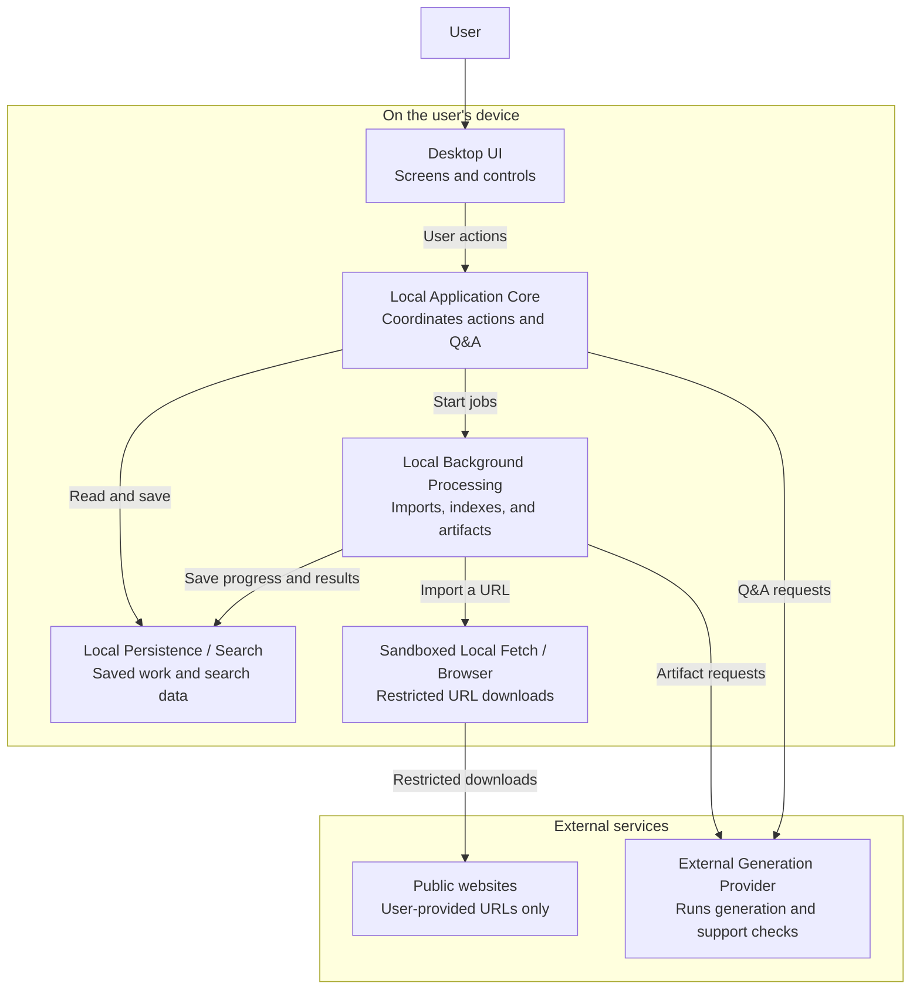
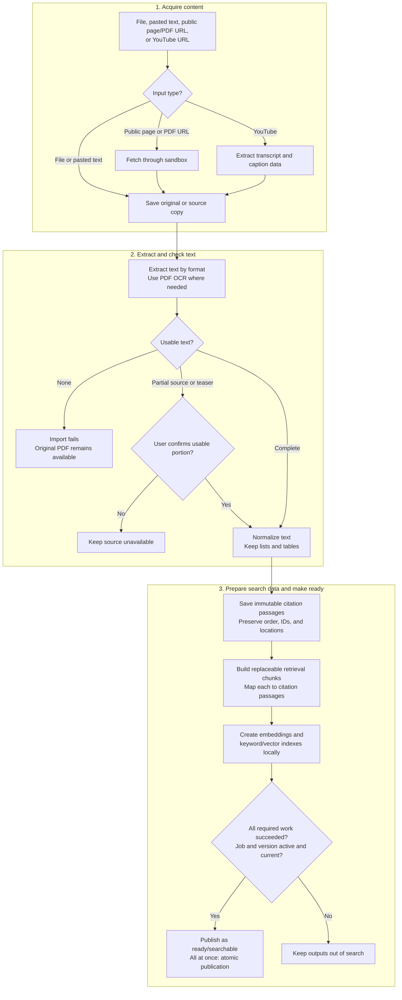
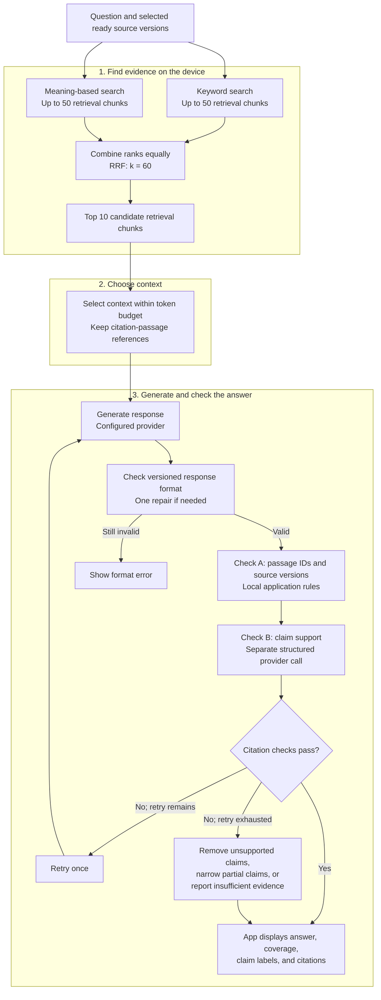

# Corpi Architecture v1

Corpi v1 is a single-user desktop app for asking questions about imported material and receiving
cited answers. This document defines its components, processing flows, and engineering constraints;
[prd.md](prd.md) defines the user-facing requirements.

| Decision status | Meaning |
| --- | --- |
| **Decided** | An accepted requirement or choice. |
| **Needs Decision** | A product or implementation choice that remains open. |
| **Partially Decided** | Some behavior is settled; the listed details remain open. |
| **Deferred** | Postponed to a named milestone or excluded from initial v1, as stated. |

## Contents

- [System design](#system-design)
  - [System overview](#system-overview)
  - [Components and responsibilities](#components-and-responsibilities)
- [Processing flows](#processing-flows)
  - [Source ingestion](#source-ingestion)
    - [Citation passages and retrieval chunks](#citation-passages-and-retrieval-chunks)
  - [Question answering](#question-answering)
    - [Answer coverage and claim support](#response-format-and-answer-coverage)
  - [Notes and artifacts](#notes-and-artifacts)
- [Storage and recovery](#storage-and-recovery)
  - [Local storage and version history](#local-storage-and-version-history)
  - [Background work and model calls](#background-work-and-model-calls)
- [Communication and security](#communication-and-security)
  - [Component communication](#component-communication)
  - [Security rules](#security-rules)
- [Decision register](#decision-register)
  - [Decided architecture choices](#decided-architecture-choices)
  - [Open implementation choices](#open-implementation-choices)
  - [Deferred scope](#deferred-scope)

## System design

Corpi separates user interaction, saved research, background processing, and external model access
into distinct responsibilities. The following sections show how those responsibilities work together.

### System overview

Users organize their work in notebooks, saved workspaces containing sources, conversations, notes,
and generated outputs. A source comes from an imported file, pasted text, a supported web page, or
a YouTube transcript. Users select which sources a question should use, then receive an answer
whose factual claims link to citation passages: fixed pieces of text saved from those sources.

Those links let users check an answer against its evidence before saving it as a note. Users can
also create artifacts, editable outputs with citations that they can keep and reuse. The exact
artifact types remain deferred, but their versioning and citation rules are part of the v1 design.

The notebook and its persistent data stay on the user's device under their operating-system (OS)
account. This local-first boundary includes original files, saved web sources, extracted text,
search data, conversations, notes, artifacts, results, and settings.

The desktop user interface (UI) passes actions to the Local Application Core. For questions and
answers (Q&A), the core first searches locally: keyword/full-text search (FTS) finds word matches, while semantic
search finds similar meanings through embeddings. Corpi generates those numerical representations
of text locally by default, using a Corpi-supported model.

The selected evidence then supplies the generation request. Generation uses the user's configured
external provider and credentials, an arrangement called bring your own key (BYOK). Corpi checks
citation references locally and makes a separate model request to check whether each cited passage
supports its claim. Generation and support checks may send the question and required selected source
text to that provider.

Initial v1 has no Corpi-hosted application backend, authentication service, database, worker fleet,
cloud object storage, or separate hosted search/vector service.

#### System/component diagram

The large groups separate work on the user's device from external services. Arrows show who
requests work or writes data. Fetched content and model replies return to the requester; background
progress and results go into local storage for the core and UI to read.

These are logical responsibilities, not a requirement to create a service or process for every
box. Long-running work must stay off the UI thread, the execution path handling screen interaction.
The fetch/browser component must run in isolation, or a sandbox, to restrict what downloaded
content can access. Other runtime and process boundaries remain open.

Both model-call arrows pass through the component authorized to make model requests. They do not
assign credentials to the core or background runner: which local component may retrieve credentials
remains **Needs Decision**.

### Components and responsibilities

A request can pass through several components, each with a distinct responsibility and set of
access limits. These descriptions identify where work happens and how its results reach the user.

#### Desktop UI

The UI lets users manage notebooks and PDF import history, inspect saved originals, import/select
sources, chat, open citations, save notes, and view or edit artifacts. Provider configuration and
local settings are available here as well.
Each action passes to the Local Application Core, and the UI displays the resulting content or
status under the [communication rules](#component-communication).

#### Local Application Core

The core receives user actions and coordinates the work needed to complete them. It manages
notebooks, sources, PDF acquisitions, and app state, reads and writes local data, and starts or tracks background jobs.
Model calls and URL fetching pass through its control boundary, so screen or source content cannot
invoke them directly. The core also records model usage when that information is available.

For a question, the core runs search, context selection, generation, and citation checks within
that request. This request-scoped path must not queue Q&A behind long-running jobs. If the question
is interrupted or disconnected before completion, its status must remain interrupted rather than complete.

#### Local Persistence / Search

Local storage keeps work between sessions. App records hold notebooks, sources, conversations,
notes, artifacts, and their relationships, while managed files hold originals, saved pages,
previews, and other large content. M1.4 stores PDF imports as notebook/source-version history
separate from the physical original bytes; several imports can refer to one verified original.

Keyword and semantic/vector indexes retrieve replaceable chunks of text that map back to fixed
citation passages. Keeping [these two text layers](#citation-passages-and-retrieval-chunks) separate
lets search change without changing the evidence behind saved answers.

A source version identifies a particular saved revision of a source's content. Keeping revisions
separate lets an old answer retain the evidence it used, even after a source changes. Prefer one
logical local storage layer where practical; add separate databases or services only for a
demonstrated need. See [storage and history](#local-storage-and-version-history) for the detailed rules.

#### Local Background Processing

When the core requests long-running work, such as an import, index rebuild, or artifact generation,
it records a job for background execution. The job runs away from the UI thread and saves progress
and results locally, allowing the core to report them to the UI.

PDF receipt first streams bytes into durable app-data staging and records an acquisition. Once the
original and source/import records commit, Corpi enqueues a `pdf-extract` job. The runner leaves that
known job queued with a visible waiting reason until M1.5 registers its extraction steps; an unknown
job kind still fails. The original remains openable during this wait or after extraction failure.

When processing steps are available, import jobs parse each format, read PDF pages, split text into
retrieval chunks, create local embeddings, and build indexes. Background execution also generates
artifacts and owns per-step progress, retries, cancellation, reuse of completed work, and the final
source-readiness check.
The [background-work rules](#background-work-and-model-calls) explain how these jobs resume
after interruption without duplicating their effects.

#### Sandboxed Local Fetch / Browser

For a supported URL import, this component receives only the request and validated parameters
needed to download the content, then returns the result to the import job. Its sandbox separates
untrusted web content from generation credentials, unrelated app data, and browser login sessions.

Every download must follow the full [URL policy](#fetch-only-allowed-public-content), including
destination checks and the one allowed browser fallback for public JavaScript pages. The specific
sandbox and browser tools remain open choices.

#### External Generation Provider

Corpi calls the user's configured model through the provider's application programming interface
(API). Generation requests contain the instructions, question, history, and locally selected
passages needed for an answer; separate support-check requests contain a factual claim and its
cited passage.

The provider returns answer content or a structured support result for Corpi to check and display.
Interactive requests come through the core's Q&A path, while artifact requests may come from
background work. Both use the authorized model component and the user's credentials.

Within these paths, searching, selecting context, generating content, and checking citations remain
separate, independently testable steps. Each passes source-version and citation-passage references
to the next. They are responsibilities within the application, not separate process requirements.

## Processing flows

Source processing establishes the evidence that later requests can use. The flows below follow
that evidence from import and readiness through question answering and artifact generation,
preserving source-version and citation-passage references along the way.

### Source ingestion

PDF byte receipt runs in an authenticated request to the local core; extraction and search
preparation run as local background work. The saved original is available before text extraction
finishes. For PDFs, extraction may include optical character recognition (OCR) to read printed text
from page images.

#### Save and inspect the original PDF

The desktop sends one raw `application/pdf` body to an authenticated loopback endpoint. The core
counts bytes while streaming into `files/staging/<acquisition-id>.part`; it doesn't accept paths
from the webview or buffer the complete upload on the event loop. Starting defaults are 25,000,000
received bytes, 120 seconds from request acceptance, and 30 seconds without bytes. A trickle resets
only the idle limit. One inbound transfer runs per core; a second receives a busy result without a
source or partial original. These values are configurable and need real-file timing evidence.

After Corpi flushes and syncs a complete staged PDF, it chooses its managed original under
`files/objects/<managed-file-id>.pdf`. The acquisition record saves the planned identity before
placement. Its canonical-original registry has a unique `(sha256, size_bytes)` key, but
`managed_files` itself allows historical duplicates. New imports verify bytes before sharing a
registered original. They may also adopt the earliest eligible old matching file on a later
Add/Replace; migration and startup never merge or rewrite those older records.

Every acquisition has a stable action key and `finalization_generation`. Before reusing an existing
file, Corpi saves an indexed `planned_reuse_managed_file_id` hold in the same transaction that checks
the durable per-file removal marker. A recoverable hold survives a crash and blocks purge until the
acquisition commits its required source reference or releases the hold under the current generation.
New-file placement intent is a planned ID/path, not a hold on another existing file. Finalization
commits the managed-file record, source/content-version and import-history links, its outcome, and a
queued job together. It uses an acquisition-specific guard because it happens before the runner has
claimed a job step.

Add matches bytes, not a filename. An identical current or pending PDF in the same notebook opens
the existing source without another history entry or processing job. Replace creates a pending
candidate while the earlier current/ready PDF stays usable. Only guarded successful readiness
publication switches the current import; failure, cancellation, or supersession leaves the previous
one in place. A changed filename alone never creates a content version.

The Files section lists current, pending, and older imports with their saved names or an honest
legacy-name fallback, date, size, processing state, and Open action. Earlier imports can enter
30-day trash only when they're neither current nor pending and no live job needs them. Whole-source
trash and earlier-import purge share the fingerprint coordinator and `managed_file_removals`
reservation with acquisition finalization. The surviving-owner check and reservation share one
short database transaction; filesystem unlink happens after that transaction and under the same
fingerprint lock. A failed unlink remains retryable. Acquisition holds, import/history links, source
versions, jobs, and unexpired trash all block a competing removal where they own the exact file.

Opening an import fetches its exact managed file with the bearer header. The core rejects a reserved
file or redirected path, verifies the opened bytes against saved size and SHA-256, and returns that
same full byte buffer with `application/pdf` and `Cache-Control: no-store`. PDF.js 6.3.289 and its
matching local worker render only the requested page, with navigation/zoom and a configurable
20-megapixel canvas bound. The full PDF is still downloaded to memory; 25 MB is an upload limit, not
a bound on decoded memory. PDF links/scripts aren't run, and PDF.js display text isn't citation
evidence. Closing or switching imports cancels renders and releases the worker, document, and canvas.

Acquisition reconciliation runs at startup before the job runner and trash sweeper, then on the
existing hourly maintenance cadence. It resumes complete staged input or a planned placement,
re-verifies reuse holds, and cleans only recorded temporary paths after writers stop. Staging with
no live writer or resumable owner becomes abandoned after 24 hours without a write. It never deletes
unexplained files from the objects directory by age alone.

Opening a notebook also discovers its unfinished acquisitions through the authenticated API.
The core reports whether an attempt can Retry, Cancel, or needs file reselection. The UI restores
those attempts after restart, including complete input still waiting for cleanup; partial input
resumes through the same acquisition after reselection rather than creating another action.
Completed and cancelled receipts remain persisted but are omitted from that unfinished list.

The viewer uses a native modal dialog: background controls cannot receive keyboard focus, and
closing it restores focus to the opening control. A fatal load error hides the empty page area
without unmounting its owned canvas. Page-render errors remain separate so another page can render
and clear the error. Native checks hold the real response/render scheduler at known boundaries to
exercise cancellation during work; the launcher checks stop/restart during an actual partial upload.

#### Import flow

Read the diagram from top to bottom. The groups are phases of an import, and diamonds are decisions.
The source remains unavailable for search throughout preparation; only the final ready step makes
it searchable. The [format rules](#read-each-format), [PDF limits](#check-pdf-pages-and-handle-partial-imports),
and [passage/chunk distinction](#citation-passages-and-retrieval-chunks) follow the diagram.

#### Read each format

| Input | Processing rules |
| --- | --- |
| Uploaded or URL-imported PDF | Start with native text, the text stored directly in the PDF. Apply the page checks and OCR rules below to all PDFs, including fully scanned and mixed documents. |
| DOCX | Use a parser that reads the document's structure, preserving headings, lists, and tables. |
| TXT/Markdown and pasted text | Read the supplied text and preserve its structure. |
| Public HTTPS page | Save the original page. Remove navigation, ads, and repeated site text (boilerplate) while keeping useful article structure. Process PDF responses under the same rules as uploaded PDFs. |
| YouTube | Read the transcript only. Keep timestamps, language, and other recorded caption details (metadata). The extraction method remains open. |

Use document tools to extract text; the generation model must not be the main parser. Keep
placeholders and page/position locations for embedded charts, diagrams, and images. V1 does not
interpret their contents.

#### Check PDF pages and handle partial imports

Check extraction quality page by page, even when the PDF has a text layer. If a page appears to
contain printed text but extraction is missing, garbled, or incomplete, run OCR while preserving
any usable native text. Check the OCR result before accepting it; a sparse or blank page alone
does not justify OCR.

These PDF upload/render/OCR limits are **configurable starting defaults**:

| Limit | Starting value |
| --- | --- |
| Received PDF bytes | 25,000,000 bytes |
| Total inbound transfer time | 120 seconds |
| Time without receiving bytes | 30 seconds |
| Document length | 200 pages |
| Rendered page size | 20 megapixels (MP) |
| OCR timeout per page | 60 seconds |
| Total OCR time per source | 10 minutes |

The idle deadline resets only when bytes arrive; the total deadline never resets. One inbound
transfer runs per core, while other API and background work remains responsive. The viewer renders
only the selected page, but it downloads the complete verified PDF into memory, which also holds
decoded resources. The 25 MB upload cap isn't an application-memory guarantee.

Time already spent counts against the total source OCR budget across retries, so retrying must
not reset that budget. Identify unreadable pages, including pages whose processing fails or exceeds
limits, and exclude them from search.

If no usable text remains anywhere in the document, fail the import clearly. If only part is
readable, identify the affected pages and require confirmation before enabling the usable portion.
Partial web pages and teasers also require confirmation. In every PDF extraction outcome, including
partial or complete failure, keep the original locally for inspection.

Every supported input path must have configurable size, length/duration, and processing-time
limits. Local embedding and other compute-heavy work also need resource limits. Exceeding a limit
must produce a clear failure. Exact non-PDF limits remain **Needs Decision**.

#### Citation passages and retrieval chunks

Convert usable text into one common clean-text format, preserving lists and tables. Keep two
separate text layers:

| Text layer | Purpose and lifetime | Identity and links |
| --- | --- | --- |
| Citation passage | Ordered, immutable extracted text with an exact source location. This is the evidence a citation opens. Its text, ID, and location stay fixed. | Belongs to a saved source version. Citations reference this passage. |
| Retrieval chunk | Text derived from one or more passages for keyword search, embeddings, and semantic search. It can be replaced when Corpi rebuilds search data. | Has a retrieval chunk ID and maps back to its citation passages. It is not a citation target. |

**In citation references, `chunk_id` is a legacy, misleading name for the immutable citation passage
ID. It is not a retrieval-chunk ID.** Preserve this meaning when passing or storing citations; see
[record identity and links](#keep-record-links-valid) for the indexed identity requirements.

Build local keyword and semantic indexes over retrieval chunks. Record the embedding model
identifier and version with every set of embeddings and its index. Replacing a retrieval chunk
must not change the passage an earlier answer cites.

#### Make a source version ready

A source version stays hidden from search while Corpi extracts text and builds search data.
It can become ready only after all required processing and indexing succeeds for the whole source
or the usable portion the user explicitly confirmed. Corpi makes it ready and searchable all at
once, an atomic publication.

Immediately before setting `ready`, check again that the job and source version are still active
and current. Cancelled, deleted, replaced, failed, or superseded work must never become searchable
or restore a source to `ready`. Intermediate outputs stay hidden from search until publication succeeds.

### Question answering

Corpi answers a question by first finding relevant source text and then supplying it to the model,
an approach called retrieval-augmented generation (RAG). The supplied material is the model's
context. Because the model measures text in tokens rather than a fixed number of words, Corpi
must select context using that model's token budget.

#### Answer flow

The two searches return retrieval chunks from the same selected, ready source versions. Corpi
combines their ranked results with equal-weight reciprocal rank fusion (RRF), then chooses context
while retaining references to citation passages. The top 10 results are candidates, not mandatory context.

Read the main path downward. Generation and support checking call the provider; search, context
selection, reference checks, and display happen locally. The format repair and citation-check retry
are separate allowances. The diagram shows the checking stage once, but every factual claim needs
the required citation checks. Passing those checks does not mean the sources fully answer the
question: [answer coverage and claim support](#response-format-and-answer-coverage) describe different things.

#### Find and combine search results

Q&A must use saved source passages as evidence. Notes cannot be independently selected or cited as
Q&A evidence. Restrict both searches to the current notebook and the user's selected, accessible,
ready source versions. Run keyword and semantic searches in parallel, returning up to 50 retrieval
chunks each.

The two searches provide complementary ways to find evidence: keyword search finds word matches,
while semantic search can find related wording. For example, a question about when something is
"due" may match a passage about a "deadline" even when the exact words differ.

Combine the two ranked lists using equal-weight reciprocal rank fusion (RRF). This combines each
result's position in the lists rather than comparing the search methods' different scoring scales:

`score = 0.5 / (60 + keyword_rank) + 0.5 / (60 + meaning_rank)`

Ranks start at 1, and a result missing from one list contributes zero for that method. Merge
matching results by source version and retrieval chunk ID, not by the citation-reference `chunk_id`.
Pass the top 10 combined results to context selection as candidates; they do not all have to enter
the prompt.

V1 has no fixed minimum relevance score (hard relevance cutoff) and no separate model to reorder
the results (reranking). Save the retrieval settings with each answer. Tune them against a small
set of hand-checked questions.

#### Choose context that fits

Choose text from the candidate retrieval chunks while retaining its citation-passage references.
Use the selected model's own token accounting to fit all parts of the request:

| Budget component | Rule |
| --- | --- |
| Source context | Start with an **8,000-token cap**, then reduce it as needed to fit the model. |
| Question, instructions, and response schema | Include the question, trusted instructions, and required output fields and structure in the total budget. |
| Conversation history | Include the history sent with the request. |
| Model output | Reserve the configured output allowance. |
| Safety margin | Reserve a configurable **512-token starting margin**. |

Keep recent chat messages verbatim and maintain a separate structured record of conversation facts
and decisions. Summarize older messages to reduce the history budget, using those records and
summaries to interpret the question rather than as evidence. Evidence must remain tied to saved
source passages.

Remove duplicate text only where it overlaps within the same source version. Similar claims from
different sources must stay separate so their independent evidence and disagreements are not lost.
Every part of the selected context must retain its passage and version references.

If the request still does not fit after choosing context and reducing history, show a clear limit
error. Do not silently truncate more text.

#### Response format and answer coverage

Require a fixed, versioned response template containing `schema_version`, the answer, supporting
claims and their support labels, citations, caveats, source conflicts, and answer coverage: the
existing full/partial/no-answer indicator. The app must check the response against its schema
version and control how it is displayed. Allow one repair attempt for a malformed response, then
show an error if it is still invalid. This format repair is separate from the one retry allowed
for failed citation checks.

The response reports two different assessments:

| Assessment | What it describes | Values |
| --- | --- | --- |
| Answer coverage | How much of the question can be answered from the selected sources. | Full, partial, or no answer: all, some, or none of the question. |
| Individual claim support | How well the cited passages support one factual claim. | Fully supported, partially supported, unsupported, or conflicting. |

For example, sources may give a date but not explain the reason for it. An answer to "When and why?"
can have partial coverage even when its date claim is fully supported.

#### Claim support and citation checks

Every factual claim needs checked citations. First check the reference with application rules,
then use a separate model call to assess whether the text supports the claim.

| Check | Required behavior |
| --- | --- |
| A: deterministic reference check | Use application rules to verify the passage ID and source version. Confirm that the passage exists and belongs to the locally stored source/version referenced by the answer. |
| B: semantic support check | Send the factual claim and cited passage through the shared model interface in a separate structured verification call. Require one of the support labels below. The verifier model/provider remains **Needs Decision**. |

| Support label | Meaning |
| --- | --- |
| Fully supported | The cited passages support the whole claim. |
| Partially supported | They support only part of the claim. |
| Unsupported | They do not provide enough evidence for the claim. |
| Conflicting | Relevant sources give incompatible accounts. |

Show source disagreements and allow one retry when a citation check fails. If that retry also
fails, remove unsupported claims, narrow partial claims to what the evidence supports, or return
an insufficient-evidence response.

Save failures as queryable local `citation_check_failures` records in Corpi-managed app data under
the user's OS account. Each record contains the answer/claim IDs, cited passage/source-version IDs,
failure reason, attempt number, and timestamp. Keep source text and model replies out of general logs.

Opening a citation must show the exact saved citation passage in context. Users can save a validated
answer as a note.

### Notes and artifacts

Notes, including saved answers, remain workspace content rather than Q&A evidence in initial v1.
Their use as artifact inputs still needs evidence and citation rules, which belong to the deferred
work on how artifacts select evidence and which selected material they cover.

Artifact generation runs in the background but follows the same general steps as Q&A: find
evidence, choose context, generate content, and check it. Each artifact uses a fixed, versioned
template so the app controls its layout and citation rules while the user can edit the result.
Use generation settings with low randomness and check consistency against test notebooks.

Save the finished result with its template version, source versions, generation settings, and
model details. Record the extraction, embedding, and index versions as well, keeping the result
tied to the text and search data that produced it.

When a newer version of a referenced source is saved, leave the artifact as it was, mark that it
uses an older source version, and notify the user. Regeneration happens only on request and creates
a new artifact version while keeping the original.

Artifacts are part of v1; their settled behavior and remaining choices are separated in the
[decision table](#open-implementation-choices). The exact catalog, retrieval strategy,
source coverage, candidate counts, and token budgets await the artifact implementation milestone.
Chat's top-10/8,000-token policy does not automatically apply to artifacts.

## Storage and recovery

Version history records which content a saved result used; recovery rules govern how interrupted
work continues. Stable identifiers and saved progress connect the two, allowing Corpi to resume
work without silently changing earlier results.

### Local storage and version history

Store content together with the details needed to interpret it, such as processing status, versions,
and links to the work that produced or used it.

| Storage responsibility | What it keeps |
| --- | --- |
| Local app records | One SQLite database under the user's Corpi app-data directory: notebooks; sources, versions and PDF import history; durable PDF acquisitions/plans; canonical-original registry and removal reservations; immutable citation passages and their retrieval-chunk links; search metadata; conversations, answers, notes, artifacts, and citations; settings and job/task state. |
| Corpi-managed files | Uploaded originals, saved web pages/PDFs, previews, generated documents/exports, and other large app-managed files. New PDF originals live at `files/objects/<managed-file-id>.pdf`; acquisition staging lives under `files/staging/`. Export behavior remains open. |
| Search indexes | Local keyword and semantic/vector indexes. Record each index version, the source versions it covers, and the embedding model and version used for semantic search. |
| Secure credential storage | External generation credentials, kept outside ordinary app/database fields. The storage/decryption technology and authorized component remain open. |

#### Keep record links valid

Store stable identifiers, status, dates, and version numbers in structured fields.
Use flexible fields for details that need to vary or expand.

Maintain valid references among sources, citation passages, citations, retrieval chunks and indexes,
answers, artifacts, and jobs. Each citation target needs a unique indexed identity equivalent to
`(source_id, passage_id, source_version)`. Here `passage_id` describes the immutable identity carried
by `chunk_id` in [citation references](#citation-passages-and-retrieval-chunks).

Index the combined identity and the referencing citation records so Corpi can efficiently locate
both a passage and every citation that depends on it. Use composite indexes and indexed foreign
keys to preserve these lookup and valid-link guarantees. Initial v1 uses one SQLite application
database through Python's standard-library `sqlite3`, with composite constraints and indexed links.

#### Local database and migrations

Store structured records for all notebooks in one SQLite database beneath Tauri's per-user app-data
directory. Keep large originals outside the database and reference them through managed-file records.
M1.4 fixes this layout for PDF originals and their acquisition staging; layout choices for later file
types remain open. Enable WAL and `synchronous=FULL`, with a configurable 5,000 ms starting lock
wait on each connection. Require SQLite 3.51.3 or newer for the WAL-reset fix, and record the
library actually loaded by Python.

Use ordered, checked-in SQL migrations with revision history and source/schema checksums. Acquire
SQLite's `BEGIN IMMEDIATE` writer lock before trusting migration history so simultaneous core starts
cannot apply the same revision. Complete runtime checks and migrations before the core reports READY.
Reject an unsupported or tampered database without repairing or replacing it. When a risky migration
needs recovery, create a bounded snapshot with SQLite's backup API.

#### Preserve sources and saved results

Never overwrite sources or saved generated results. Refresh web sources only on request, creating
a new source-content version only if the content changes. Old answers and artifacts must retain
the exact versions they used:

| Version | What it identifies |
| --- | --- |
| Source version | The imported content. |
| Extraction version | The saved text produced from that content. |
| Embedding/index version | The search data used. |

These separate references distinguish a changed source from a change in how Corpi processed or
searched it. Changing the embedding model or its version therefore creates a new embedding/index
version and rebuilds the affected semantic indexes rather than replacing old records.

For example, refreshing a web source may save changed content as a new version. An earlier answer
must still open the passage from the version it used. Rebuilding retrieval chunks or changing the
embedding model must not move that citation to the refreshed text.

Save exact results and how they were produced, with edits, regenerations, and explicit migrations
creating new saved versions. Template changes apply only to new outputs; old answers and artifacts
keep their original content and schema versions, along with matching renderers, the code that
displays each saved version. Never silently migrate or regenerate old outputs.

#### Delete only Corpi-managed data

Ordinary deletions keep data in local trash for 30 days before purging linked records, citation-check
records, search/index data, files, caches, and affected derived content. Cancel affected work as
part of deletion so resumed jobs cannot recreate deleted content.

Corpi controls only its own local app data. It cannot remove copies in OS backups, manual exports,
cloud-sync folders, or other locations outside its control. Corpi provides no cloud backup
infrastructure or hosted recovery guarantees. Local backup/export/restore behavior remains
**Needs Decision**.

### Background work and model calls

Background execution must distinguish completed work from work that still needs to run. The
following rules use checkpoints and stable job identifiers to preserve that distinction across
restarts and retries, including requests that may incur provider charges.

#### Resume work without duplicating it

Save a progress checkpoint after every background step, allowing a job to resume after a crash or
app restart and recognize completed work. Show progress as steps finish, with retry, cancel, and
source-replacement options where applicable.

Each logical job needs a stable idempotency key so retries recognize the same work instead of
duplicating its effects. Use step-specific keys for file writes, indexing, and paid model calls,
reusing those keys across retries and enforcing uniqueness on job/output records.

Calls to external models and other APIs must have explicit timeouts and bounded retries. Apply
the following processing/API retry rules together; the answer-format repair and citation-check
retry allowances are defined separately in [Q&A validation](#response-format-and-answer-coverage).

| Situation | Required handling |
| --- | --- |
| Temporary failure | Retry only temporary failures, within a fixed attempt cap. |
| Provider supports idempotency | Use the provider's support to recognize repeated requests. |
| Paid-call outcome is unknown and the provider lacks idempotency support | Do not repeat the call automatically. Establish its outcome or flag it for review. |

A lost response does not prove the provider failed to process or charge for the request. The
task/process mechanism and general timeout/retry values remain open.

Reuse completed deterministic parsing, OCR, chunking, and embedding work when content, versions,
and settings match. Be conservative when reusing generated answers: similar questions can require
different answers.

#### Control what model calls send

BYOK applies only to external generation credentials. The authorized component sends the
instructions, question, and required history and source context for generation, or the claim and
cited passage for a support check. Interactive calls come from the request-scoped Q&A path, while
artifact calls may come from background work. Every response must pass the applicable versioned
schema and validation rules.

Corpi-supported embeddings run locally by default, so users need no embedding API credential and
retrieval chunks stay on the device for indexing. Record the model identifier/version with each
set. Additional explicitly supported local or remote embedding backends may come later, but initial
v1 does not require arbitrary user-supplied models. Any later remote backend must use the same
timeout and retry rules.

#### Handle provider usage and errors

If a provider rejects a call because of credit/quota, rate limits, credentials, or another
restriction, stop the affected model action and show a clear provider-side explanation when one
is available. Existing local data must remain accessible.

Track token counts and API usage locally when the provider supplies enough information. Charges
use the user's provider credentials. Initial v1 has no Corpi service-side user quotas, subscriptions,
or account upgrade/reset flow. Optional user-configured spend/token safeguards remain **Deferred**.

## Communication and security

Communication contracts define what passes between components. Security rules then restrict how
untrusted content, fetched pages, and model calls can affect the application.

### Component communication

Each handoff must preserve the evidence references and access limits described below. The exact
transport remains open: UI-to-core calls may use functions, a local API, or inter-process
communication (IPC). An internal HTTP server is not required.

| Connection | Rules |
| --- | --- |
| Desktop UI ↔ Application Core | Route app actions through the core; UI content cannot directly change search internals, retrieve credentials, or bypass sandboxed fetching. |
| Core ↔ Background Processing | Record jobs and share progress/results through local storage for the core/UI to read. PDF receipt is a pre-job acquisition; only a durable finalization transaction creates its queued processing job. No external job-routing service is assumed. |
| Background Processing ↔ Fetch/Browser | Exchange only the fetch request, validated import parameters, and fetched content. Never send credentials or unrelated app state. |
| Authorized model component ↔ Provider | Send required instructions/context with configured credentials; accept only responses that pass schema and validation checks. The credential-holding component remains open. |
| Search ↔ Context selection ↔ Generation ↔ Citation checks | Keep steps independently testable and retain source-version and citation-passage references, including when candidates are dropped or rearranged. |

These rules define responsibilities and the data passed between components. They do not specify
endpoints or choose a communication protocol.

The shipped Tauri UI calls the Python core over authenticated loopback HTTP. Notebook, PDF
acquisition, retry/cancel, history, storage, and binary-view routes use the per-launch bearer token
and pass the same `Origin`/`Host` checks. CORS preflight permits the write methods and headers those
requests need. PDF viewing fetches the exact import with the bearer header; the route returns one
verified full-file response and does not claim byte-range support.

### Security rules

Imported content must remain evidence rather than a source of authority. The fetch sandbox, model
request assembly, and credential boundary enforce that rule in different parts of the application.

#### Fetch only allowed public content

A supplied URL must not make Corpi contact private/internal services or cloud metadata endpoints.
This guards against server-side request forgery (SSRF), where an attacker uses the app to make
unintended network requests. A cloud metadata endpoint can expose details or credentials for the
machine hosting it; it is not a public document source.

- Accept only user-provided public HTTPS pages and direct PDFs on port 443.
- Validate the resolved IPv4 and IPv6 destinations immediately before connecting. Connect only to
  a validated address, and repeat validation after every redirect.
- Apply the same checks to every browser subrequest, subresource, and redirect.
- Block private/internal destinations and cloud metadata endpoints, including `169.254.169.254`
  and known metadata hostnames.

The isolated fetch/browser component must have no access to generation credentials, sensitive
app state, browser cookies, login sessions, or unrestricted local-network resources. It must also
enforce security, size, and time limits; follow robots.txt, the site's rules for automated fetching;
and apply per-domain request-rate limits shared across the Corpi installation.

Cache eligible public content locally for 15 minutes per installation, respecting robots.txt and
cache restrictions while excluding signed URLs and URLs specific to a user.

Try a normal download first. If a public page needs JavaScript, allow at most one isolated browser
attempt with no cookies, login state, downloads, pop-ups, or device access. Every browser request
must follow the same destination checks and rate limits.

Never bypass paywalls, sign-ins, CAPTCHAs, robots.txt restrictions, or other access controls. When
a page fails, explain why and ask for content the user can legally provide; a partial page or
teaser still requires confirmation before import.

#### Treat source text as data, not instructions

All uploaded or imported content is untrusted, including pasted text and transcripts. Retrieved
text cannot override app/system instructions, authorize actions, or obtain secrets. Keep trusted
instructions structurally separate from retrieved source context when assembling model requests.

#### Restrict credential access

Only the authorized model component may retrieve and use generation credentials. Source content,
prompts in retrieved documents, the desktop UI, and the fetch sandbox cannot directly request or
read stored credentials. Use an appropriate secure local credential mechanism, not ordinary
app/database fields.

The database and Corpi-managed research files stay under the user's OS-account and app-data
boundary. Initial v1 does not add Corpi-managed encryption; copied database or file data is not
promised to remain confidential. Provider credentials remain separate and must use secure local
credential storage outside ordinary database fields. Single-user v1 needs no hosted account/session
or workspace authorization service. The app controls how responses are displayed, and fixed citation
passages keep their evidence stable.

## Decision register

The tables below separate accepted architecture choices from unresolved implementation details.
Deferred items also state whether they await the artifact milestone or fall outside initial v1.

### Decided architecture choices

| Area | Decided v1 choice |
| --- | --- |
| Deployment and storage | One-user desktop app. App records, managed files, embeddings, and search indexes stay local. |
| Search | Local keyword and semantic search. Equal-weight RRF with k=60, up to 50 candidates per method, and top 10 passed to chat context selection. No reranking model. |
| Execution | Handle Q&A within its request. Run imports, indexing, and artifact creation as local background work that can resume without duplicating completed effects. |
| Evidence | Keep citation passages immutable and retrieval chunks replaceable. Check references with app rules and claim support with a separate model call. |
| Models | Use the user's configured external provider and BYOK credentials for generation. Corpi manages local embeddings by default. |
| History | Make ready versions available all at once. Preserve source/output versions and template/rendering versions. Regenerate only on request. Use 30-day local trash. |
| Local database and research-data protection | Use one standard-library SQLite database under the per-user app-data directory, relational versioned records, immutable citation passages, ordered SQL migrations, and the OS-account/app-data protection boundary without additional Corpi-managed research-data encryption in initial v1. Keep provider credentials in separate secure storage. |
| Desktop shell and local core | Tauri 2 + React/TypeScript shell; Python 3.13 core managed with uv; FastAPI over loopback HTTP with a per-launch bearer token, `Origin`/`Host` validation, and authenticated API requests through `fetch` (or a WebSocket authenticated on connect). Monorepo with `core/`, `desktop/`, and a root justfile. Electron is the documented fallback if Tauri sidecar packaging proves too painful. |
| Background job runner and source lifecycle | One in-process asyncio runner per core with a bounded worker pool and durable SQLite job/step records; completion is proven by committed `job_steps` rows, never by status flags; one core per data directory via an OS advisory lock taken before database initialization; per-step-class timeout and retry starting defaults with the policy recorded on the job; cooperative cancellation with a guarded commit that rejects late results; atomic readiness publication through a readiness record with a currency recheck; 30-day trash with a resumable startup and wall-clock sweeper. |
| PDF acquisition, original sharing, and viewer | Receive one authenticated raw PDF at a time with 25,000,000-byte, 120-second-total, and 30-second-idle starting limits. Keep durable acquisition attempts, planned placement IDs/paths, exact reuse holds, and an atomic pre-job finalization guard. Share verified immutable bytes through a `(sha256,size_bytes)` registry without merging source/evidence identities; coordinate every removal through the fingerprint lock and durable removal reservation. Fetch full verified bytes through the bearer-authenticated core and bundle matching PDF.js 6.3.289 assets/worker. Render selected pages under a configurable 20 MP bound. |

### Open implementation choices

Choose and record each open implementation detail before building the component it affects.

| Area | Status | What remains open |
| --- | --- | --- |
| Local keyword/FTS and vector search | **Needs Decision** | Both search implementations. PostgreSQL, `ts_rank_cd`, and pgvector are not selected v1 requirements. |
| Local embeddings | **Needs Decision** | Supported model and runtime; benchmark them before selection. Local-by-default processing is decided. |
| Generation credentials | **Needs Decision** | Secure storage/decryption technology and which local component may retrieve/use credentials. |
| Local file layout | **Partially Decided** | PDF original/staging paths, safe copy, integrity verification, and shared-original removal are set by M1.4. Layouts for other file types remain open. The research-data protection boundary is decided: OS-account/app-data protection without extra Corpi-managed encryption in initial v1. |
| Generation and verification models | **Needs Decision** | Provider/model choice. A supported local-generation alternative remains optional; its implementation and support commitment are unresolved. |
| Fetch/browser | **Needs Decision** | Sandboxing and browser tools. |
| Format tools | **Needs Decision** | Native PDF extraction library, separate OCR engine, DOCX parser, HTML/boilerplate extractor, and YouTube transcript method/library. |
| Resource limits | **Needs Decision** | Non-PDF limits and remaining API timeout/retry/resource values. Limits, bounded retries, and PDF/OCR starting defaults are already required; step-class timeout/retry starting defaults were set with the background job runner (see the decided choices). |
| Desktop delivery | **Needs Decision** | Packaging, distribution, and updates. |
| Local backup/export/restore | **Needs Decision** | Backup/export/restore behavior and implementation. |
| Overall artifact requirements | **Partially Decided** | Template and saved-output rules in [notes and artifacts](#notes-and-artifacts) are settled; the remaining details are listed below. |
| Artifact types and evidence selection | **Deferred** | Exact catalog, retrieval/source-coverage strategy, candidate counts, and token budgets await the artifact milestone. Evidence/citation rules for note inputs remain unresolved. |

### Deferred scope

The following capabilities are **Deferred / not initial v1**.

- Selecting or citing notes as Q&A evidence; collaboration, accounts, and shared-workspace authorization.
- Discovering sources from a topic, automatically crawling links, or searching the live web during
  answers. Automatic academic-source discovery and peer-review verification/filtering are also deferred.
- Audio input/output and interpreting charts, diagrams, photographs, or video frames. Importing
  PPTX, XLSX, standalone images, and handwriting is outside initial v1.
- A separate reranking model or hosted/external search/vector service.
- Additional embedding backends and optional user-configured usage/spend safeguards.

Artifact details await their implementation milestone; artifact creation itself remains part of v1.
